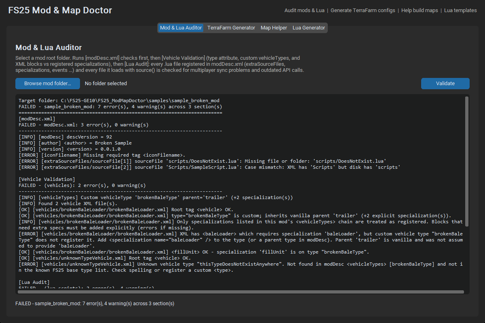
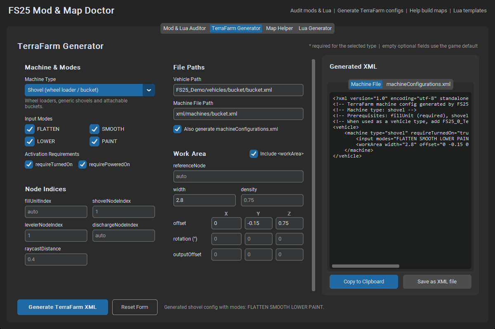
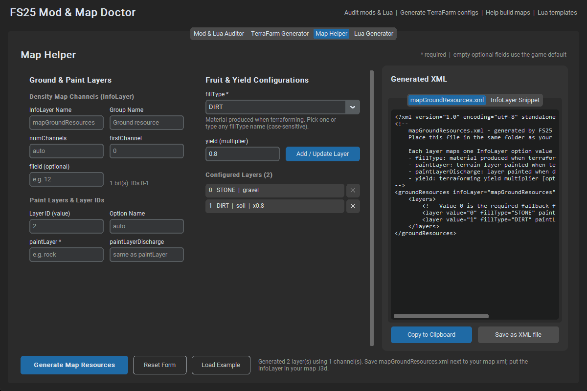
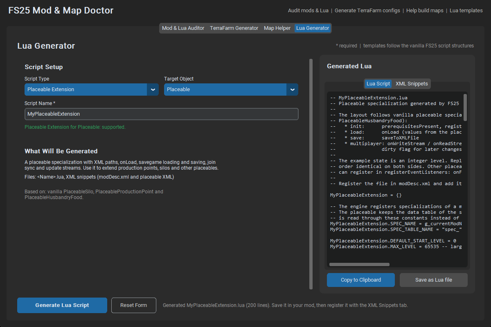

<div align="center">

# FS25 Mod & Map Doctor

**v0.7.0 &nbsp;|&nbsp; An all-in-one local development suite for Farming Simulator 25 modders, scripters and map makers.**


*Catch the problems that crash dedicated servers and desync multiplayer sessions **before** you upload your mod,
and generate correct boilerplate instead of writing it from memory.*

</div>

---

## Table of Contents

1. [Overview](#overview)
2. [What's New in v0.7.0](#whats-new-in-v070)
3. [What's New in v0.6.0](#whats-new-in-v060)
4. [What's New in v0.5.0](#whats-new-in-v050)
5. [What's New in v0.4.0](#whats-new-in-v040)
6. [What's New in v0.3.0](#whats-new-in-v030)
7. [What's New in v0.2.0](#whats-new-in-v020)
8. [Key Features](#key-features)
   - [Mod & Lua Auditor](#1-mod--lua-auditor)
   - [TerraFarm Configuration Generator](#2-terrafarm-configuration-generator)
   - [Map Helper](#3-map-helper)
   - [Lua Script Generator](#4-lua-script-generator)
9. [Configuration & How It Works](#configuration--how-it-works)
10. [Installation & Usage](#installation--usage)
11. [Using the Tool: Tips & Parameters](#using-the-tool-tips--parameters)
12. [Project Structure](#project-structure)
13. [Running the Test Suite](#running-the-test-suite)
14. [Known Limitations](#known-limitations)

---

## Overview

Building an FS25 mod usually means a long loop of *edit, zip, start the game, read `log.txt`, repeat*. Many mistakes
never show up on your own Windows machine at all: a wrongly capitalised file name works on NTFS and then kills a Linux
dedicated server, and a `writeStream` that does not match its `readStream` only breaks when a second player joins.

**FS25 Mod & Map Doctor** moves that feedback loop onto your desktop. It is a local, offline toolkit with four tabs:

| Tab | What it is for |
| --- | --- |
| **Mod & Lua Auditor** | Validate `modDesc.xml`, vehicle XML, fill types, foliage, DDS headers, ModHub leftovers, localization keys, i3D references, husbandry placeables and Lua scripts. |
| **TerraFarm Generator** | Build TerraFarm machine XML (shovel, leveler, trencher, excavator, compactor, ripper, excavator ripper, discharger) with a visual form. |
| **Map Helper** | Build `mapGroundResources.xml` and the matching `InfoLayer` snippet for a map. |
| **Lua Generator** | Generate multiplayer-aware Lua templates plus the XML needed to register them. |

Nothing is uploaded and no Lua is ever executed. Everything runs on your machine.

<div align="center">



</div>

---

## What's New in v0.7.0

### Base-game fill types and shop categories

The fill-type catalog is the `fillType` names in `reference/maps_fillTypes.xml` (177 names). `OATS`, `COFFEE`, `GRAVEL`, `SAND` and `DIRT` are not in that file. `mapGroundResources.xml` uses `fillType="DIRT"` without defining it, so `DIRT` is not treated as a base-game fill type. `GRAVEL` in that example is a paint layer. Fruit names were not guessed from foliage filenames.

Shop categories come from `reference/storeCategories.xml`. `StoreManager:getCategoryByName` compares `string.upper(name)`.

* `STORE-006` — a `storeData` category token is not in that file and not declared as a `storeCategory` on this mod. The loader logs "Invalid category" and skips the name.
* `STORE-007` — a listed store item has no accepted category while `showInStore` is enabled. The loader logs "No categories defined in store data! Using 'misc' instead!" and uses `MISC`. An unlisted file is not checked, because `loadItem` is not called for it.

---

## What's New in v0.6.0

### Store items the shop drops

The auditor adds a **Store Items** section. It reads every `storeData` block and copies two warnings from `Documentation/docs/script/Shop/StoreManager.md`:

* `STORE-002` — `name` is missing or empty. The loader logs "Name missing for storeitem. Ignoring store item!" and drops the item.
* `STORE-001` — `image` is missing or empty while `showInStore` is enabled (the documented default is true). The loader logs "Image icon is missing for storeitem. Ignoring store item!" and drops the item. `showInStore` text `false` does not warn. A value whose boolean meaning is not in the local sources, such as `0`, is not warned either.
* `STORE-003` — a file listed in `modDesc.xml` `storeItems` has no `storeData` child. The loader logs an xmlError, "No storeData found. StoreItem will be ignored!", and drops that item. The mod still loads, so this is a warning. A file that is missing, or that is not listed as a store item, is not reported here.
* `STORE-004` — `price` is a plain number below 0. The loader logs "Price has to be greater than 0. Using default 10.000 instead!" and substitutes 10000. The comparison in code is `price < 0`, so `0` and a missing `price` do not warn.
* `STORE-005` — `lifetime` is a plain number that is `0` or below. The loader logs "Lifetime has to be greater than 0. Using default 600 instead!" and substitutes 600. A missing `lifetime` does not warn.

The image path is not checked on disk. `Utils.getFilename` runs after this warning, and its base directory is not in the local sources.

---

## What's New in v0.5.0

### Lua sandbox errors

The Lua auditor now reports three load-breaking calls in the mod's own scripts. Comments and strings are ignored. The rules were run against all 267 vanilla Lua files in `Documentation/FS25-lua-scripting-main` and stayed silent there.

| Rule | What it catches |
| --- | --- |
| `LUA-SAN-001` | `os.time()` and `os.date()`. The sandbox call is nil (`references/pitfalls/what-doesnt-work.md`, `references/giants-source/VERIFIED-FACTS.md`). |
| `LUA-SAN-002` | `table.move()`. Zero hits in the corpus; `table.pack()` is left alone. |
| `LUA-SAN-003` | Authored `goto` and `::label::`. Decompiler shapes `goto l12` and `::l12::` are not flagged. |

### TerraFarm ripper, excavator ripper and discharger

The generator dropdown now includes the three machine types documented in `Documentation/docs/MACHINE_RIPPER.md`, `MACHINE_EXCAVATOR_RIPPER.md` and `MACHINE_DISCHARGER.md`.

* Ripper and excavator ripper use `type="ripper"` and `type="excavatorRipper"`, the example mode order `LOWER FLATTEN SMOOTH PAINT`, and a work area that requires `referenceNode` and `width`. They do not write `fillUnitIndex`.
* Discharger writes no `<input>` block. `fillUnitIndex` and `dischargeNodeIndex` stay on `<machine>`. `raycastDistance` and `outputOffset` stay on `<workArea>`. An empty `dischargeNodeIndex` is omitted so the documented default `1` applies. The input-mode checkboxes are disabled for this type.

Field `polygonIndex` from `field/Field.lua` is not checked. `Field:load` reads it with `getUserAttribute` on a live node, and this tool does not decide which i3D node is a field.

---

## What's New in v0.4.0

### Husbandry placeable load checker

The Mod & Lua Auditor now runs a **Husbandry** section. It reads `<placeable>` XML and checks the `placeable.husbandry` attributes that the FS25 loader rejects or silently skips. The rules are the `onLoad` branches in `Documentation/FS25-lua-scripting-main/animals/husbandry/placeables/`.

| Rule | Severity | What the loader does |
| --- | --- | --- |
| `HUS-001` | Error | `animals#type` missing or blank. `PlaceableHusbandryAnimals:onLoad` logs "Missing animal type!" and sets the loading state to error. |
| `HUS-002` | Warning | A `deliveryArea` is missing `startNode`, `widthNode`, or `heightNode`. `loadDeliveryArea` returns false and the area is dropped. |
| `HUS-003`–`HUS-005` | Error | `feedingRobot` is missing `filename`, `class`, or `linkNode`. Each one stops the placeable load. |
| `HUS-006` | Warning | A feeding-robot `spline` has no `node`. The loader logs it and stops reading further splines. |
| `HUS-007` | Error | A fence `section` has no `segmentId`, and `fence#xmlFilename` is set. The section loop logs "Missing segment id". |
| `HUS-008` | Error | A `customizable="true"` fence section is not last. The loader logs that and stops. |
| `HUS-009` | Warning | A meadow `fruitType` has no `name`. `getFruitTypeByName` skips it with no log line. |
| `HUS-010` | Warning | A vanilla meadow fruit is missing a growth-state attribute. The loader logs it and skips that fruit. |
| `HUS-011`–`HUS-013` | Warning | A milking robot is missing `filename`, `class`, or `linkNode`. The loader skips that robot. |
| `HUS-014` | Warning | A `palletTrigger` has no `node`. The loader ignores it and writes no log line. |
| `HUS-015` | Error | The file contains a husbandry placeable but the XML does not parse. |

A folder with no husbandry placeable reports `HUS-000` as info. Info does not fail the suite.

The checker does not read collision masks. `PlaceableHusbandryPallets.lua` tests `CollisionFlag.VEHICLE` on the loaded shape, and no local file assigns that bit's number. It also does not invent unload-trigger elements: `UnloadTrigger.createTriggers` has no function body in the local sources. Animal type names and meadow growth-state names are not compared with a catalog, because those tables are resolved at runtime.

---

## What's New in v0.3.0

### ModHub Compliance & Texture Suite

The Mod & Lua Auditor now runs a **ModHub Compliance** section on every folder validation. It is a static reader.
It does not convert, resize, or flip textures, so it cannot introduce a compression mismatch or a
"Texture was flipped with quality loss" warning of its own.

**DDS header scan.** Each `.dds` file is opened read-only. Python's `struct` module unpacks the 128-byte header
(and the 20-byte DX10 extension when the FourCC is `DX10`). Pixel blocks are never decoded. The suffix rules follow
`Documentation/All compression types.pdf`:

| File | Expected format | Mipmaps |
| --- | --- | --- |
| Normal (`_n`, `_normal`) | BC1 | yes (`mipmapCount > 1`) |
| Diffuse (`_diffuse`) with an alpha flag | BC7 | yes |
| Diffuse (`_diffuse`) without an alpha flag | BC1 | yes |
| Height (`_height`) | BC4 | yes |
| Specular (`_specular`) | BC1 | yes |
| `mod_icon` | BC1 | no |
| `store_icon` | BC7 | no |

A width or height that is not a power of two is a warning on every DDS file. A file that is not a DDS header is an error.
Alpha is taken from the header flags. BC7 is treated as alpha-capable because a DX10 header has no separate "alpha used" bit.

**Junk scan.** `.git`, `.github`, `.blend`, `.blend1`, `Thumbs.db` and `desktop.ini` are errors. A `.git` folder is
reported once; the files inside it are not listed one by one.

**Localization.** A `$l10n_` key in `<title>`, `<description>`, or a store item's `<name>`, `<description>` or
`<function>` must exist in an inline `<l10n>` block or in a local dictionary (`l10n_en.xml`, or
`<l10n filenamePrefix="..."/>` plus `<prefix>_en.xml`, as described in the skill's localization notes). A missing key
is a warning. Vanilla keys such as `$l10n_typeDesc_tipper` on other vehicle elements are not part of this check.

| Rule | What it catches |
| --- | --- |
| `DDS-001` | The file is not a readable DDS header. This one is an error. |
| `DDS-002` | Block compression does not match the suffix row above. |
| `DDS-003` | Mipmaps are missing on a map that needs them, or present on `mod_icon` / `store_icon`. |
| `DDS-004` | Width or height is not a power of two. |
| `HUB-001` | A developer leftover that should not be in a ModHub zip. This one is an error. |
| `L10N-001` | A title, description or store text key has no matching localization entry. |
| `L10N-002` | A declared `filenamePrefix` has no English file, or a localization file cannot be parsed. |

`DDS-000` is an info line: either the file matches its row, or the suffix has no row in this matrix.

**I3D scenegraph.** The auditor reads `.i3d` files named by `vehicle.base.filename` and `placeable.base.filename`
(the paths registered in `Vehicle.lua` and `Placeable.lua`). It parses them as XML and does not rewrite them.
Rules follow the Giants i3D 1.6 schema: a `fileId` that is not declared on `Files/File` is `I3D-001`, a `filename`
that does not match the disk with exact case is `I3D-002`, a repeated `nodeId` on a TransformGroup in `Scene` is
`I3D-003`, and a repeated `fileId` in `Files` is `I3D-004`. These are warnings.

**Localization across languages.** A `<text name="...">` key that exists in `l10n_en.xml` (or `translation_en.xml`)
and is missing from another language file in the same set, such as `l10n_de.xml`, is `L10N-003` (info). English
remains the fallback, so this does not fail the mod.

**Store Item Generator.** The Lua Generator tab has a Store Item sub-tab. It writes a `<storeData>` block from
`StoreManager.registerStoreDataXMLPaths`: name, brand (default `LIZARD` when you type one), category (schema default
`misc`), price, and an optional image. Washable adds `<washable />` beside that block. Component configurations add
`storeData.bundleElements` with the configuration name you enter. Copy and Save use the Store XML output tab.

---

## What's New in v0.2.0

### Fill Types & Foliage Auditor

The Mod & Lua Auditor now runs a fourth section, **Fill Types & Foliage**, on every folder validation (GUI and
`python main.py --validate`). It reads `map.xml` references, `fillTypes.xml`, `fruitTypes.xml` and foliage XML, and
reports the same failures the vanilla loaders already log. It also reports converter rules those loaders drop
without a message.

Names are compared with `string.upper()`, which is what `getFillTypeByName` and `getFruitTypeByName` do. A lowercase
`wheat` still matches `WHEAT`. The tool records that the stored name is the upper-case form (`FILL-007`, `FRUIT-012`).

**Vanilla fallback catalog.** If a name is not defined in the mod, it is checked against
`app/knowledge/vanilla_materials.py` before a missing-name warning. The catalog has **47 fill types** and **19 fruit
types**: the core crops and ground materials (wheat, barley, oats, canola, maize, sunflower, soybean, potato, sugar
beet, cotton, sugarcane, grape, olive, coffee, rice, spinach, stone, dirt, gravel, sand) plus every `FillType.NAME`
and `FruitType.NAME` the bundled FS25 scripts actually use. `UNKNOWN` is not included. Stone, dirt, gravel and sand
are fill types only. A standard crop such as `WHEAT` or `RICE` therefore passes when the mod does not redefine it.
A name in neither the mod nor the catalog still warns. This is not a full copy of `data/maps/maps_fillTypes.xml`.

| Rule | What it catches |
| --- | --- |
| `FILL-000` | A `fillTypes` / `fruitTypes` `filename` that is missing or has the wrong letter case. |
| `FILL-001` | The same fill type defined twice. The later block wins. |
| `FILL-002` | An empty fill-type, category or converter name, or a name that is not one identifier. The loader ignores it. |
| `FILL-003` | A fill-type category that names a type this mod does not define and the vanilla catalog does not know. |
| `FILL-004` | A `fillTypeConverter` rule the loader **silently drops**: `#from` or `#to` does not resolve, or `#factor` is missing or not a number. |
| `FILL-006` | A `fillTypeSound` that names an unknown fill type. |
| `FRUIT-001` | A `fruitType` entry with no `#filename`. |
| `FRUIT-002` | A fruit filename that is not on disk, or a foliage file with no `<foliageType>` root. |
| `FRUIT-003` / `FRUIT-004` | Foliage with no `fruitType#name`, or a name that is not an identifier. The fruit is ignored. |
| `FRUIT-005` | `fruitType#name` does not match a mod fill type or a vanilla fill type after `string.upper()`. The loader ignores the whole fruit. |
| `FRUIT-006` | A fruit category that names a fruit that was not loaded and is not in the vanilla fruit catalog. |
| `FRUIT-007` | A `fruitTypeConverter` rule the loader **silently drops** because `from` or `to` does not resolve. A missing `#factor` is not a drop: the loader uses 1 (`FRUIT-015`, info). |
| `FRUIT-008` | A second withered, prepared, regrowth, cut, weed, mulched, rolled or ground-type state. The later state overwrites the first. |
| `FRUIT-009` | A state that can be destroyed by a wheel or a disaster, with no state to change into. |
| `FRUIT-010` | A windrow `#fillType` or `#cutFillType` that is not a known fill type. The loader ignores the windrow. |
| `FRUIT-011` | A harvest transition whose source or target state is not defined. |
| `FRUIT-013` | A `foliageState` with no `#name`. The loader calls `string.upper` on it. This one is an error. |
| `FRUIT-014` | The same fruit type loaded from a second foliage file. The later file replaces the first. |

`FRUIT-000` is an info line for a foliage file that no `fruitType#filename` points at. The loader never reads that file.

---

## Key Features

### 1. Mod & Lua Auditor

One click runs eight checks in sequence and prints a single sectioned report (`modDesc.xml`, `Vehicle Validation`,
`Fill Types & Foliage`, `ModHub Compliance`, `Store Items`, `I3D Scenegraph`, `Husbandry`, `Lua Audit`). Every finding has a severity (error, warning or info) and a
stable rule ID. The fill-type rules are listed under [What's New in v0.2.0](#whats-new-in-v020). The texture, junk and
localization rules are listed under [What's New in v0.3.0](#whats-new-in-v030).

**modDesc.xml and file references**

- Checks the structure of `modDesc.xml`: root element, `descVersion`, the required `author`, `version` and
  `iconFilename` tags, and the files referenced from `extraSourceFiles` and the other file entries.
- **Linux-safe, case-sensitive path checking.** Windows will happily open `Scripts/MySpec.lua` when the file is
  really called `scripts/myspec.lua`. A Linux dedicated server will not, and the mod fails to load there. The
  validator walks every path component against the real directory listing and reports wrong casing, including the
  casing of `modDesc.xml` itself. This is how you prevent that class of **Dedicated Server crash** on a PC that
  would never show it.

**Vehicle XML and specializations**

- Cross-references the blocks inside a vehicle XML against the specializations its `vehicleType` actually provides,
  using a bundled table of **261 vehicle XML block to specialization mappings**. If your XML contains a block such
  as `<machine>` or `<wearable>` but the vehicle type does not include the specialization that reads it, the block is
  silently ignored by the engine. The auditor tells you which specialization is missing.
- Resolves custom `<vehicleTypes>` declared in your `modDesc.xml` and flags unknown types.
- For vanilla vehicle types the full specialization list is not embedded, so those mismatches are reported as
  **warnings** rather than errors. The tool does not claim certainty it does not have.

**Static Lua scanner (multiplayer safety)**

The Lua audit is a **heuristic, text-based scanner**. Comments and string contents are blanked out first, so a
`streamWriteBool` inside a comment never counts. Lua files are discovered from `modDesc.xml` plus any literal
`source("...")` calls.

| Rule | What it catches |
| --- | --- |
| `LUA-EVT-001` / `LUA-EVT-008` | Event classes without a working `emptyNew()` (the engine creates events on the receiving side with it). |
| `LUA-EVT-002` | An event with `writeStream()` but no `readStream()` (or the reverse). |
| `LUA-EVT-004` | **Stream asymmetry:** `writeStream()` and `readStream()` do not read and write the same types in the same order. |
| `LUA-EVT-005` / `LUA-EVT-006` | Client requests that are never relayed, and `sendEvent()` that only reaches one direction. |
| `LUA-SPEC-001` / `002` / `003` | Missing `prerequisitesPresent`, `registerEventListeners`, or registered handlers that do not exist. |
| `LUA-SPEC-003` / `004` | Specialization `onWriteStream`/`onReadStream` (and update-stream) pairs that are missing or do not match. |
| `LUA-SPEC-005` | An update stream that never raises dirty flags, so clients never receive it. |
| `LUA-OLD-009` and legacy API rules | **321 deprecated vehicle XML paths** inherited from FS19/FS21/FS22, plus 8 legacy Lua API patterns. Each hit names the replacement. |

> **Why it matters:** read/write asymmetry is the classic multiplayer bug. It works in single player, works for the
> host, and then corrupts the stream or disconnects clients as soon as someone joins.

The auditor only flags an API as outdated when the vanilla scripts themselves mark it deprecated or never use it
while using a documented replacement. API that vanilla code still uses is deliberately **not** flagged, to avoid
false alarms.

---

### 2. TerraFarm Configuration Generator

A visual wizard for TerraFarm machine configuration. It produces two standalone,
well-formed documents: the machine file (`<vehicle><machine/></vehicle>`) and `machineConfigurations.xml`.



- **Machine types:** shovel (wheel loader / bucket), leveler (blade / grader), trencher, excavator and compactor.
- **Safe Vector3 inputs.** Offset, rotation and output offset are entered in horizontal **X / Y / Z** grids instead of
  one free-text string like `0 0.5 1.2`. That removes the usual typos: missing components, commas instead of spaces,
  and swapped axes.
- **Automatic `n/a` field masking.** Fields that do not apply to the selected machine type are greyed out and marked
  `n/a`. A leveler or trencher has no shovel node, and a compactor has no fill unit or node settings, so you cannot
  fill in settings that the machine would ignore. Fields that a type *requires* (for example the trencher's fill unit,
  reference node and width) are marked with `*`.
- **Two output tabs** (machine XML and registration XML) so each file stays a valid, standalone XML document.
- Shows a short description of the selected machine type, and writes a `Prerequisites` comment into the generated
  XML listing which specializations the vehicle needs (for example `fillUnit` and `shovel`).

---

### 3. Map Helper

A visual builder for the ground resources that TerraFarm reads from your map, based on `MAP_RESOURCES.md`. It
produces `mapGroundResources.xml` and the `InfoLayer` snippet that belongs in your map `.i3d`.



- **Ground & Paint Layers card:** the InfoLayer name and group, `numChannels`, `firstChannel`, optional `fileId`,
  and the list of layer IDs with their `paintLayer` and optional `paintLayerDischarge`.
- **Fruit & Yield Configurations card:** a `fillType` dropdown (or any custom fill type name) and a **yield
  multiplier** for each layer.
- **Binary channel capacity logic.** An InfoLayer stores its value in density-map *bits*, so the number of layers you
  can paint is `2^N`, not `N` squared:

  | Channels (bits) | Layer IDs you can use |
  | :---: | :---: |
  | 1 | 0-1 |
  | 2 | 0-3 |
  | 3 | 0-7 |
  | 4 | 0-15 |

  The form shows the live capacity next to the channel field. If you leave `numChannels` empty it picks the smallest
  channel count that fits your highest ID. If you set one that is too small, it tells you instead of generating a
  layer that cannot be painted.
- **Well-formed output.** Two documents are generated: `mapGroundResources.xml`, and an `InfoLayer` snippet (saved
  as `mapResources.i3d.xml`) for you to paste into your map `.i3d`. The `InfoLayer` is **not** a standalone `.i3d`
  file and does not go into `map.xml`.
- Copy to Clipboard and Save as XML file are available for both outputs.

> The documentation page spells one attribute `paintLayerDisharge` while its own examples use
> `paintLayerDischarge`. The tool follows the examples.

---

### 4. Lua Script Generator

Generates complete, ready-to-edit FS25 Lua templates and the precise XML snippets you need in `modDesc.xml`.



| Script Type | Target | What you get |
| --- | --- | --- |
| **Custom Specialization Mod** | Vehicle | `prerequisitesPresent`, `initSpecialization`, `registerFunctions`, `registerEventListeners`, `onLoad`, `onUpdate`, `onDelete`, savegame `saveToXMLFile`, plus `onWriteStream`/`onReadStream` and `onWriteUpdateStream`/`onReadUpdateStream` with dirty flags. |
| **Network Event Script** | Vehicle, Placeable or Game Environment | An `Event` subclass with `emptyNew()`, `new()`, `readStream()`, `writeStream()`, `run()` and `sendEvent()`. Comments mark exactly where **server-side safety checks** belong (sync check, range check, permissions and ownership). |
| **Placeable Extension** | Placeable | `registerXMLPaths`, savegame paths, `onLoad`, `loadFromXMLFile`, `saveToXMLFile`, stream and update-stream handlers. |

- **Multiplayer-ready by default.** Server and client roles are handled in the template, state changes go through the
  server, and clients get updates through dirty flags.
- **Companion XML.** The second output tab contains the `modDesc.xml` entries (`<multiplayer supported="true" />`,
  `<specializations>`, `<extraSourceFiles>`, `<vehicleTypes>` or `<placeableTypes>`) and a sample vehicle or
  placeable XML fragment.
- **Validated names.** The script name must be a valid Lua identifier, is checked against Lua keywords and engine
  globals, and is converted to the correct case (`MyThing` for the class, `myThing` for the XML name).
- Generated code is checked against the project's own Lua auditor and must produce **zero findings**.
- The save button follows the visible tab: *Save as Lua file* or *Save as XML file*.

---

## Configuration & How It Works

The rules in this tool are not guesses. They are derived from two documentation sets that sit next to the project:

| Source folder | Used for |
| --- | --- |
| `Documentation/docs/` | The XML documentation: `MACHINE_*.md`, `MAP_RESOURCES.md`, `INDEX.md`, and the script reference. |
| `Documentation/FS25-lua-scripting-main/` | The vanilla Lua sources: how events, specializations and placeables are really structured. |

**How the knowledge gets into the app**

1. Extraction scripts in `scripts/` (`_extract_spec_map.py`, `_extract_deprecated_xml.py`, `_analyze_lua_source.py`)
   read those folders and produce compact data files in `app/knowledge/`:
   - `xml_block_to_specialization.json`: 261 XML block mappings
   - `lua_deprecated_xml_paths.json`: 321 deprecated XML paths
   - `lua_rules.py`: the legacy API and network rules, each carrying its **evidence** from the vanilla code
2. At runtime the app loads those bundled files. **It does not need the `Documentation/` folders to run**, and it does
   not read them while you work.
3. `scripts/calibrate_lua_auditor.py` and the test suite re-check the rules against the vanilla scripts. Rules that
   flagged things vanilla code still does were removed.

**Safe by design.** The Lua auditor only reads your scripts as text. A small scanner blanks comments and strings and
finds function bodies by counting block keywords. **It never runs, loads or `require`s any Lua file**, so a mod you
download from anywhere can be audited without risk.

> Because the checks are heuristic, a finding is a *likely problem with a rule ID*, not a proof. Each message says what
> was found and what the vanilla scripts do instead.

---

## Installation & Usage

### Requirements

- **Python 3.10 or newer** (developed and tested on Python 3.14)
- **CustomTkinter** (`>=5.2.0,<7`; tested with 6.0.0)
- A desktop with Tk available. Developed and tested on **Windows 11**; the code is plain cross-platform Python, but
  other platforms have not been tested.

### Install

```bash
pip install customtkinter
```

or, from the project folder:

```bash
pip install -r requirements.txt
```

### Launch the GUI

```bash
python main.py
```

### Command-line validation (smoke testing and CI)

Run the full audit without opening a window:

```bash
python main.py --validate <mod_folder>
```

It prints the same sectioned report as the GUI and sets the exit code, so it works in scripts and CI:

| Exit code | Meaning |
| :---: | --- |
| `0` | Passed (no errors). |
| `1` | At least one error was found. |

Try it on the bundled samples:

```bash
python main.py --validate samples/sample_ok_mod       # passes
python main.py --validate samples/sample_broken_mod   # reports errors, exits with 1
```

---

## Using the Tool: Tips & Parameters

- **`*` means mandatory.** Fields marked with an asterisk must be filled in. If one is empty, the tool shows an
  error in the status bar next to the Generate button, highlights the field, and generates nothing.
- **Empty optional fields use the game default.** Leave an optional field blank and the attribute is simply **left out**
  of the generated XML, so the game engine applies its own default. For example, an empty `yield` means the game uses
  `1.0`, and an empty `paintLayerDischarge` means it uses `paintLayer`. You never have to guess default values.
- **Grey text is a placeholder, not a value.** It shows an example of the expected format and is never written to
  the output.
- **Try "Load Example" first.** In the **Map Helper**, the **Load Example** button fills the form with the example
  layers from `MAP_RESOURCES.md`. Click it, then **Generate Map Resources**, to see a complete working output
  straight away.
- **Reset Form** clears a tab and restores its defaults. It is available on the TerraFarm, Map Helper and Lua
  Generator tabs.
- **Copy to Clipboard** and **Save as ... file** act on the output tab you are looking at. Each tab saves its own
  document, so the XML stays well-formed.
- **Read the status line.** The bar at the bottom of each tab reports what was generated or why generation failed.

---

## Project Structure

```text
FS25_ModMapDoctor/
|-- main.py                     # GUI launcher and --validate CLI
|-- requirements.txt
|-- README.md
|-- app/
|   |-- core/                   # models, case-sensitive path helpers, Lua scanner
|   |-- validators/             # modDesc, vehicle, fill/foliage, ModHub, i3D, husbandry and Lua auditors
|   |-- generators/             # TerraFarm, map resources and Lua generators
|   |-- knowledge/              # bundled rule data derived from the documentation
|   `-- gui/                    # main window, tabs and reusable widgets
|-- samples/                    # sample_ok_mod and sample_broken_mod
|-- scripts/                    # tests and knowledge-extraction tools
`-- docs/images/                # README screenshots
```

---

## Running the Test Suite

Each script is standalone and exits non-zero on failure. The GUI tests open a real window briefly.

```bash
python scripts/store_auditor_test.py       # storeData name and image
python scripts/terrafarm_types_test.py      # ripper, excavator ripper, discharger
python scripts/husbandry_auditor_test.py  # husbandry placeable attributes
python scripts/i3d_store_test.py          # i3D headers and storeData XML
python scripts/modhub_compliance_test.py  # DDS headers, junk files, localization
python scripts/fill_fruit_auditor_test.py # fill types and foliage
python scripts/lua_auditor_test.py        # Lua auditor rules
python scripts/lua_generator_test.py      # generated templates
python scripts/gui_smoke_test.py          # TerraFarm tab
python scripts/map_helper_smoke_test.py   # Map Helper tab
python scripts/lua_tabs_smoke_test.py     # Auditor and Lua Generator tabs
```

`lua_generator_test.py` can also run the generated Lua inside a real Lua VM with a mock engine to verify that stream
reads and writes match. That layer needs the optional, **development-only** package `lupa`
(`pip install lupa`) and is skipped automatically when it is not installed.

---

## Known Limitations

Being honest about what the tool can and cannot promise:

- **Heuristic Lua analysis.** The scanner is not a full Lua parser. Expect the occasional false positive or missed
  case, and treat results as strong hints.
- **Generated Lua is not verified by the game itself.** Templates are checked by the project's auditor, by a mock
  engine and for XML well-formedness, but not by a running copy of FS25. Test them in-game before release.
- **Event registration.** The event templates end with a guarded `InitEventClass(...)` call. The `registerEventId`
  style call is not used because it does not appear in the reference sources. If your game version needs a different
  registration call, change the single block in `lua_generator.py` (`EVENT_REGISTRATION_BLOCK`).
- **Unconfirmed engine names.** Details such as `g_currentModName` and the exact specialization table key are taken
  from vanilla usage but could not be fully confirmed from the stripped reference sources.
- **Vanilla vehicle types** are only partly embedded, so some specialization checks on them are warnings.
- **Vehicle XML and husbandry placeables.** The vehicle section checks vehicle files. The Husbandry section checks
  `placeable.husbandry` attributes listed under [What's New in v0.4.0](#whats-new-in-v040). It does not check collision
  masks, unload-trigger child elements, animal type names, or whether a meadow growth-state name exists on the fruit.
  A fence section is checked only when `fence#xmlFilename` is set, because `onLoad` returns before the section loop
  otherwise. `customizable="true"` is the only value treated as customizable; the boolean parser is not in the local
  sources. Other placeable types are not validated. The Lua auditor still checks placeable specialization scripts.
- **Static knowledge.** Rules reflect the documentation snapshot they were built from. Future game updates may need
  new extraction runs.
- **DDS reader is header-only.** It does not decode pixels and it never writes a texture. Whether a BC7 file actually
  uses its alpha channel is not visible in the DX10 header, so a BC7 diffuse is checked against the "with transparency"
  row. A suffix that is not in the v0.3.0 matrix (for example `_mask` or `_distance`) is reported as info, not as a
  format error.
- **Vanilla fill and fruit catalog.** Fill names are the base-game `maps_fillTypes.xml` list. Fruit names are not
  taken from foliage filenames. A fill type added by a DLC, and not by the mod, still warns. The numeric fill-type
  cap (`SEND_NUM_BITS`) is not checked, because that constant is not assigned in the documentation set.

---

## License

Released under the [MIT License](LICENSE).

---

<div align="center">

Made for the FS25 modding community.

</div>
